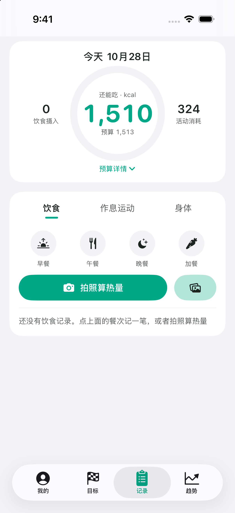
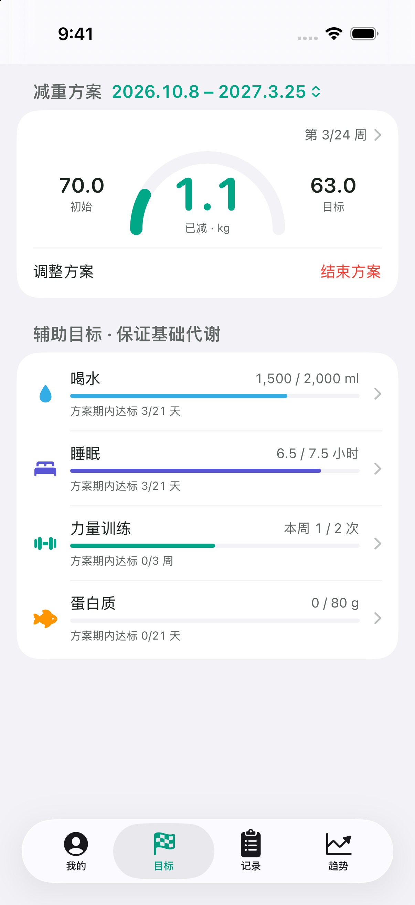
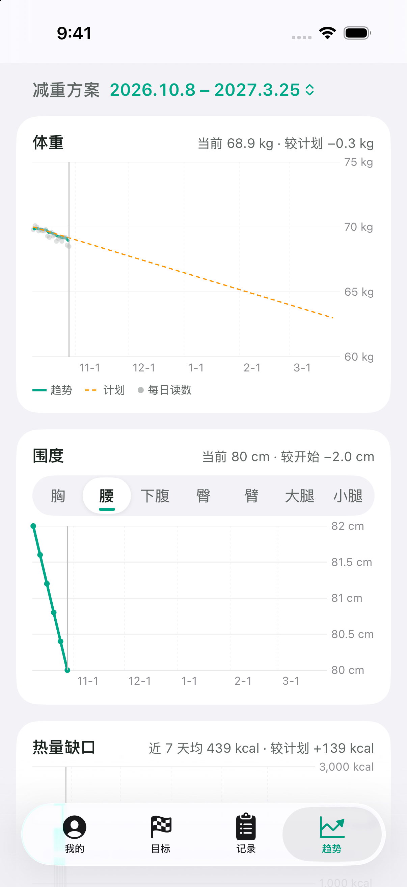

# 轻盈 · qingying

个人减脂记录 iOS App（SwiftUI）。记饮食算热量预算、拍照估热量、看体重和围度趋势、按减重方案跟进度，读写 iPhone 健康 App；可选 Google 登录，把数据备份到你自己的 Firebase 项目。记录和趋势的功能范围参考了薄荷健康。

| 记录 | 目标 | 趋势 |
|---|---|---|
|  |  |  |

## 功能

- **记录**：早餐、午餐、晚餐、加餐；搜索内置食物库、自定义食物、手填热量；复制最近 7 天同一餐次。喝水、睡眠、步数、运动、体重和围度（胸、腰、臀、手臂、大腿、小腿、下腹）
- **热量预算**：基础代谢 + 活动消耗 × 吃回比例 − 每日缺口，不低于摄入下限（女 1200 / 男 1500 kcal）
- **拍照估热量**：视觉模型只识别菜名和克数，热量按食物库换算，炒菜另加烹调油；结果可以逐项修改、左滑删除
- **目标**：减重方案（起点、目标、每日缺口推算达成日期），结束或调整的方案归档，可以删除；喝水、睡眠、力量训练、蛋白质四个辅助目标
- **趋势**：体重 7 日趋势线和计划线对比，围度、热量缺口、喝水、睡眠、步数等图表，可按方案切换
- **健康 App**：读步数、活动和静息能量、体能训练、睡眠、喝水、体重、身高、性别、出生日期；写回饮食热量、体重、喝水

数据存在本机 `Documents/boohee.json`，不登录也能完整使用。

## 构建

需要 Xcode 26 和 [XcodeGen](https://github.com/yonaskolb/XcodeGen)（`brew install xcodegen`）。

1. 把 `ios/project.yml` 里的 `PRODUCT_BUNDLE_IDENTIFIER` 改成你自己的
2. iPhone 用数据线连 Mac，打开开发者模式，然后：

```bash
cd ios
DEVELOPMENT_TEAM=<你的 Team ID> DEVICE=<iPhone UDID> ./build.sh   # 生成工程、构建、安装、启动
```

用免费 Apple ID 签名时，App 7 天后打不开。重新跑一次 `build.sh` 覆盖安装即可，本机数据会保留；不要先删 App，删了数据就没了。

## 云备份（可选）

1. 在 [Firebase](https://console.firebase.google.com/) 新建项目：Authentication 里开启 Google 登录，再建一个 Firestore 数据库
2. 部署安全规则（每个用户只能读写自己的 `users/{uid}`）：

```bash
cd firebase
firebase use --add          # 选你的项目
firebase deploy --only firestore:rules
```

3. 在项目里添加 iOS App（bundle id 和上面一致），下载 `GoogleService-Info.plist`，放到 `data/firebase/GoogleService-Info.plist`。`data/` 已在 `.gitignore` 里，不要提交这个文件

没有这个文件时 App 照常使用，账号区显示「未配置」。

同步规则：登录时如果云端已有数据，按记录 id 合并进本机；之后每天凌晨由系统后台任务上传一次，也可以在「我的」点「立即同步」，都是以本机为准整份覆盖云端。从多任务里划掉 App 后，系统不会执行后台任务。

## AI 识别

「我的 → AI 识别」里可以选 OpenAI、Anthropic、Gemini、DeepSeek 或任意 OpenAI 兼容接口。API Key 只存在 iPhone 钥匙串里，不写进数据文件，也不上传云端。

## 说明

- 内置食物库（`ios/BooheeLite/foods.json`）约 60 条，数值是近似值，没有逐条核对；需要精确时用自定义食物覆盖
- 拍照估算普遍偏低，界面上的数字四舍五入到 10 kcal 并给出区间
- 只做了浅色模式和竖屏
